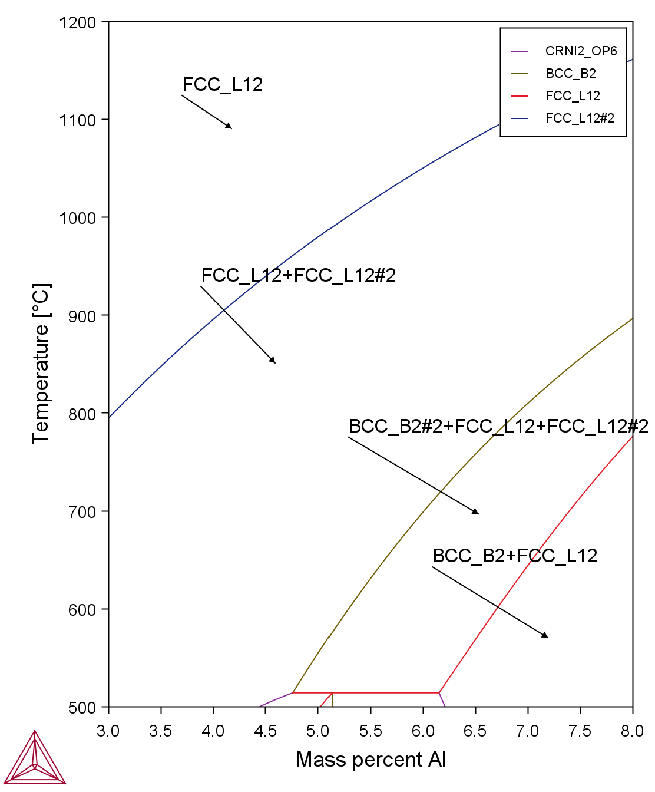
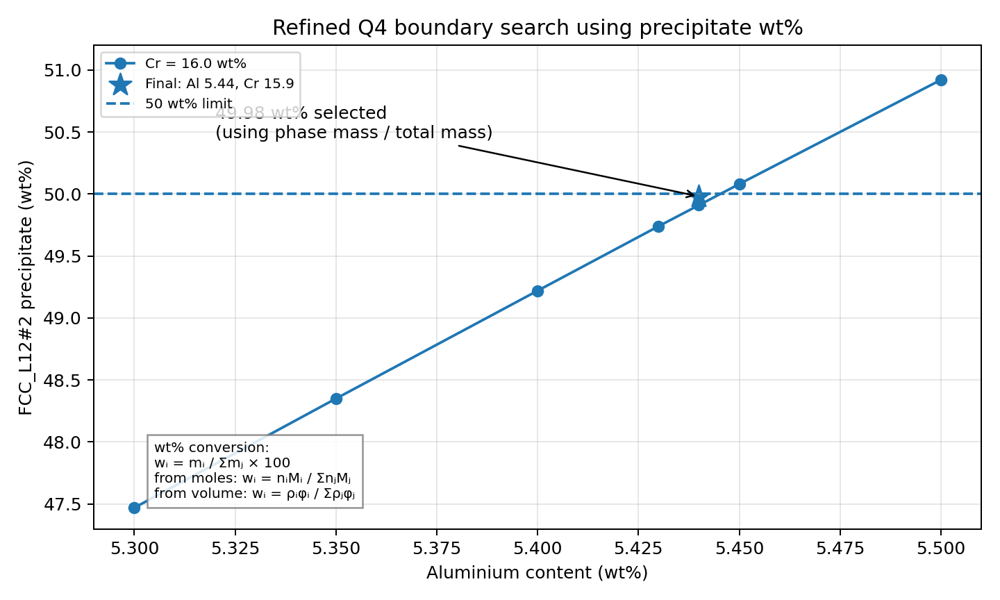

# Computational Design of a Ni–Cr–Al Superalloy Using Thermo-Calc

A CALPHAD-based materials design study using **Thermo-Calc** to examine how heat treatment and alloy composition influence phase stability, precipitation strengthening, oxidation-performance metrics, and density in a simplified Ni–Cr–Al superalloy system.

This project was completed for **MCEN90014 Materials Engineering at the University of Melbourne** and reformatted as a portfolio-ready technical project.

## Project Overview

Nickel-based superalloys derive much of their high-temperature strength from a Ni-rich FCC matrix strengthened by ordered γ′ precipitates. This study used equilibrium thermodynamic calculations to connect **processing → microstructure → properties → composition selection**.

Baseline alloy and heat treatment:

- **Composition:** Ni–16Cr–3.4Al (wt%)
- **Solution treatment:** 1050 °C for 2 h
- **Ageing:** 800 °C for 16 h

The analysis focused on whether the prescribed heat treatment forms the intended γ/γ′ microstructure, how Al changes precipitate stability, how Al and Cr can be optimized under design constraints, and how composition changes affect estimated density.

## Methodology

Thermo-Calc equilibrium calculations were performed for the Ni–Cr–Al system using temperature sweeps, Al-content sweeps, Al–temperature phase mapping, Al–Cr grid calculations, and refined single-equilibrium calculations near the final design boundary.

Relevant Thermo-Calc phase labels were interpreted as:

- `FCC_L12` — Ni-rich γ matrix
- `FCC_L12#2` — γ′-type strengthening precipitate
- `BCC_B2` — competing B2-type intermetallic phase
- `CRNI2_OP6` — additional low-temperature equilibrium phase

The assignment-specified precipitation-strengthening relation was

\[
\Delta \sigma = 800\sqrt{f_{ppt}}
\]

where \(f_{ppt}\) is the relevant precipitate fraction.

The supplied empirical oxidation-performance metric was

\[
k = 10^{-4}\exp(-9c_{Al}-c_{Cr}),
\]

with \(c_{Al}\) and \(c_{Cr}\) expressed as mass fractions.

For density comparison, an ideal additive-volume approximation was used:

\[
\frac{1}{\rho_{mix}} = \sum_i \frac{w_i}{\rho_i}.
\]

## Key Results

### Heat-treatment response

At **1050 °C**, the baseline alloy is predicted to lie in a single FCC phase field, supporting the solution-treatment step. At **800 °C**, the equilibrium structure contains both the FCC matrix and `FCC_L12#2`, consistent with the intended γ + γ′ aged microstructure.

For the base alloy at 800 °C, the calculated γ′-type precipitate fraction is approximately **0.08366**, corresponding to a strengthening increment of approximately **231 MPa** using the supplied model.

### Effect of aluminum

Increasing Al strongly increases the predicted `FCC_L12#2` fraction. However, composition cannot be considered independently of temperature because the stable phase fields shift substantially across the Al–temperature design space.

<p align="center">
  
</p>

At high Al content, `BCC_B2` begins to appear, creating a phase-stability limit on simply maximizing γ′ fraction.

### Best sampled Al-only composition

Within the available discrete Al candidate set, the highest equal-weight performance index occurred at:

**Ni–16Cr–4Al (wt%)**

| Metric | Result |
|---|---:|
| Strengthening increment | 375.7 MPa |
| Empirical oxidation metric | \(5.95\times10^{-5}\) |
| Normalized performance index | 1.259 |

This is reported as the **best sampled composition**, rather than an exact continuous optimum, because the available candidate set was discrete.

### Strength-maximized constrained composition

When Al and Cr were both varied and the γ′-type precipitate content was constrained below **50 wt%**, the strongest tested feasible composition was:

**Ni–15.90Cr–5.44Al (wt%)**

with:

- `FCC_L12#2` = **49.98 wt%**
- \(\Delta\sigma\) = **565.6 MPa**
- no `BCC_B2` detected in the targeted final check

<p align="center">
  
</p>

### Density comparison

The higher-Al candidate compositions were also predicted to have lower density than the baseline alloy.

| Composition | Estimated density |
|---|---:|
| Ni–16Cr–3.4Al baseline | 7.98 g/cm³ |
| Ni–16Cr–4Al sampled optimum | 7.88 g/cm³ |
| Ni–15.90Cr–5.44Al strength optimum | 7.66 g/cm³ |

For rotating turbine hardware, this reduction in density can be beneficial because it reduces centrifugal loading, although density cannot be optimized independently of phase stability and mechanical performance.

## Repository Structure

```text
.
├── README.md
├── main.tex
├── REVISION_NOTES.md
└── figures/
    ├── heat_treatment_cycle.png
    ├── temp_sweep_high.png
    ├── temp_sweep_low.png
    ├── al_temperature_map.png
    ├── al_sweep_800.png
    ├── high_al_b2.png
    ├── performance_index.png
    ├── q4_grid_full.png
    ├── q4_grid_zoom.png
    ├── q4_boundary.png
    └── density_corrected.png
```

The README intentionally shows only the two most useful figures. The full analysis and complete figure set are contained in the LaTeX report.

## Report

`main.tex` contains the complete technical report and is ready to compile in **Overleaf** using pdfLaTeX.

`REVISION_NOTES.md` documents the major technical and presentation revisions made while converting the original coursework into a cleaner engineering report.

## Technical Limitations

This work is an **equilibrium thermodynamic screening study**, not a complete alloy qualification. Thermo-Calc equilibrium calculations do not directly predict precipitation kinetics, precipitate morphology, coarsening, coherency loss, or experimentally measured mechanical behavior. The strengthening and oxidation relationships were simplified models supplied for the assignment, and the density calculation is a first-order estimate.

Experimental validation and kinetic modeling would be required before translating the selected compositions into an engineering alloy specification.

## Skills Demonstrated

- CALPHAD-based computational materials engineering
- Thermo-Calc equilibrium modeling
- Ni-based superalloy phase interpretation
- γ/γ′ precipitation-strengthening concepts
- Composition–processing–microstructure–property relationships
- Constraint-based alloy design
- Multi-objective engineering optimization
- Technical writing in LaTeX / Overleaf

## Author

**Jeonghyun Park**  
Mechanical & Aerospace Engineering  
Princeton University

Study completed during coursework at the **University of Melbourne**.

## Reproducibility Note

The repository includes the report source and processed figures used in the final write-up. The original Thermo-Calc project/database files are not included, and the exact Thermo-Calc software release and thermodynamic database version were not recorded in the original report.

For full computational reproducibility, future work should archive the software and database versions, saved Thermo-Calc project files, exported numerical data, and composition-grid refinement settings.

## Academic Context

This repository presents coursework as a technical portfolio project. It is intended to demonstrate the computational workflow, engineering reasoning, and communication of a materials-design study rather than to present the results as a peer-reviewed alloy-development study.
